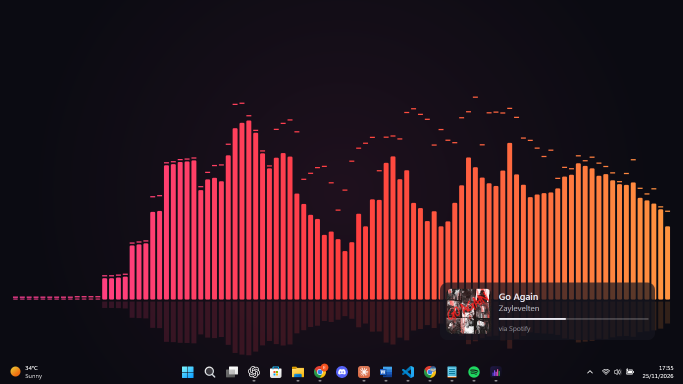

# Music Visualizer

A Windows music visualizer that lives in your **system tray** and runs as a **live desktop wallpaper**. The part that runs all day is a small native engine (Rust + Direct2D); the settings window (C# / WPF) only runs while it's open. It reacts to everything your PC plays, or only to the apps you pick (for example just Spotify), and shows what's playing in Spotify.



## Features

- **Live wallpaper first:** start it and it runs behind your desktop icons straight away, with no window. It lives in the system tray; click the icon to customize it. It can start with Windows.
- **Album cover in the middle** of the screen, bouncing with the beat, with the song and artist next to it wherever you like.
- **Make it yours:** style, colors (song-art colors, rainbow or your own), position, size, intensity, background glow and a picture behind the visualizer, with a live preview.
- **Listen to the apps you choose:** everything on the PC, or only selected apps such as Spotify or a browser. Other sounds (game audio, notifications, calls) are ignored.
- **Cycle through styles** on a timer or every few songs, each with its own saved settings.
- **Seven styles:** Bars, Mirror, Blocks, Spectrum, Radial, Ring and Wave, with as many or as few bars as you like.
- **Back to your normal wallpaper when it's quiet:** when nothing is playing, your usual desktop background fades back in, and the visualizer returns with the music.
- **Now-playing:** album art, title, artist and progress, read through Windows from the app you're listening to (Spotify, a browser, …). No sign-in, free accounts included. When you listen only to chosen apps, it shows the one that played most recently, one app at a time, and never another app's song.
- **Light on your PC:** while drawing the wallpaper it uses about 5–8% of one CPU core and 45–60 MB of memory (20–30 MB of its own), roughly 2–4× less CPU and 3× less memory than version 1.6. Nothing is drawn while a window covers the wallpaper or nothing plays.
- **Visualizer window** (optional): fullscreen, keyboard shortcuts, play/pause/skip, and audio files (mp3, wav, flac, m4a, aac, wma, aiff).

## Install

Run `MusicVisualizer-Setup-<version>.exe` (built into `dist\`). It installs for your Windows user only, so there's no admin prompt. You can choose:

- where to install (default `%LocalAppData%\Programs\Music Visualizer`),
- **Start with Windows**: on by default. It starts quietly in the tray when you sign in.
- a desktop shortcut, and
- whether to start the wallpaper when setup finishes.

It adds two Start-menu entries: **Music Visualizer** (runs the wallpaper) and **Music Visualizer Settings**.

Running a newer setup over an existing install updates it in place and keeps your settings. Setup also replaces version 1.0.0, which used a different installer.

To uninstall, run the setup again and click **Uninstall**, or use *Settings → Apps → Installed apps → Music Visualizer*. Both remove the app, its shortcuts, the startup entry and your settings.

Windows may show a SmartScreen warning the first time, because the installer isn't code-signed. Choose *More info → Run anyway*.

## Using it

**Start Music Visualizer and it becomes your wallpaper.** No window opens: the visualizer appears behind your desktop icons, and a notification points you to the tray icon the first time. It keeps running in the **system tray** (bottom-right of the taskbar; it may be under the **^** arrow).

| To… | Do this |
|---|---|
| Start the wallpaper | Start **Music Visualizer** (Start menu, desktop shortcut), or click **▶ Run as wallpaper** in settings, or right-click the tray icon → **Wallpaper** |
| Change how it looks | Click the tray icon, or start **Music Visualizer Settings** |
| Stop the wallpaper | **■ Stop wallpaper** in settings, or right-click the tray icon → **Wallpaper** |
| Stop everything | Right-click the tray icon → **Stop**, or **Stop** in settings. Your normal wallpaper comes back, and Music Visualizer stays in the tray, using almost no memory or CPU, so one click starts it again. |
| Close it completely | Right-click the tray icon → **Exit completely** |

Starting **Music Visualizer** again while the wallpaper is already running opens settings.

### Settings

The left side shows a **live preview** shaped like your wallpaper screen, the **▶ Run as wallpaper** / **■ Stop wallpaper** button, and which **screen** the wallpaper covers (with two or more monitors). *Run as wallpaper* starts it and closes the settings window. Changes apply to the running wallpaper immediately and are saved automatically.

**Appearance tab**

| Setting | What it does |
|---|---|
| **Look** | The style (see below). **Each style remembers its own settings** (colors, position, size, bars, intensity, album art...); the song title card's position (or hidden) and its brief pop-up too. Frame rate and the background picture are shared. Peak caps and reflection on/off. **Number of bars** (16 to 128; fewer looks bolder and simpler) and bar thickness. |
| **Colors** | *Song art colors* (the default): a gradient between the two main colors of the album cover that's playing, for every song. Black-and-white covers give greys and white, and when the music stops it keeps the last song's colors. It never switches to the rainbow, and colors blend over about a second when the song changes. *Rainbow*: cycles colors with the beat. *My colors*: a gradient between two colors; pick from the swatches or type a hex code like `#FF4D6D`. |
| **Position and size** | Move it left/right and up/down, scale it (**Size**), and set how much of the screen's **Width** it spans. **Center it** puts it back in the middle. |
| **Cycle styles** | *Switch between styles automatically*: tick the styles to use, then change **after some time** (15 s to 1 hour) or **after some songs** (1 to 10), in order or in *random order*. Each style shows with its own saved settings. |
| **Song title** | Where the song card (album art, song and artist) appears on the wallpaper: any corner, top or bottom center, or hidden. When it's hidden, *show it in the bottom right for a few seconds when a new song starts* (on by default) still announces each new song. |
| **Album art** | *Show the album cover in the middle*. The cover always stays in the center of the screen; the position sliders move only the visualizer. Radial and Ring size it to fit their circle; the other styles show it behind the visualizer, bouncing with the beat and the glow. When it's on you also get **Cover size**, **Bounce** (from still to big), **Bounce sharpness** (from a soft swell with the bass to a sharp kick on strong beats), where to write the **song and artist** (below, above, left or right of the cover, or hidden), and *Hide the song title card*. |
| **Intensity** | From *Calm* to *Wild*: how strongly it reacts to the music. Turn it up for quiet music. |
| **Sensitivity by frequency** | Four sliders that make parts of the sound move it more or less (see below). **Even out** resets them. |
| **Background** | The glow that pulses with the bass (on/off and strength; like the album cover it stays in the center of the screen), and a **picture behind the visualizer**: choose a file, or **Use my current wallpaper**. **Darken picture** helps the visualizer stand out. The picture is copied into the app's settings folder, so moving the original doesn't break it. |
| **Reset appearance** | Back to the defaults (keeps your picture). |

**Audio tab**

| Setting | What it does |
|---|---|
| **Listen to** | *Everything on this PC*, or *Only the apps I choose*. |
| App list | Apps that have played sound. Tick the ones to visualize. Ticked apps that aren't running are remembered and picked up when they start. Click **Refresh** after starting a new app. |
| **When nothing is playing** | *Show my normal wallpaper until music plays again* (on by default), after it has been quiet for 2 to 60 seconds (5 by default). It listens to what you chose above, so with only Spotify chosen, other sounds don't bring the visualizer back. |

**Styles**

| Style | Looks like |
|---|---|
| Bars | Classic spectrum bars with peak caps and a reflection |
| Mirror | Bars growing up and down from a centre line |
| Blocks | LED-meter style stacked blocks |
| Spectrum | A smooth filled curve, like a studio analyser |
| Radial | Bars around a circle that pulses with the bass |
| Ring | The sound wave bent into a circle |
| Wave | The raw sound wave, like an oscilloscope |

**Sensitivity by frequency**

| Slider | Range | What's usually there |
|---|---|---|
| Bass | 40–250 Hz | Kick drums, bass lines, 808s: the thump you feel |
| Low mids | 250 Hz–2 kHz | The body of vocals, guitars, piano and snare: where most melody lives |
| High mids | 2–6 kHz | Vocal clarity, snare crack, plucks and claps: the attack of each sound |
| Treble | 6–16 kHz | Hi-hats, cymbals, shakers and breath: the sparkle and air |

They affect the bar-based styles and Spectrum. Ring and Wave draw the raw sound wave, so only *Intensity* changes them.

**General tab:** **Start with Windows** starts it in the tray when you sign in, and brings the wallpaper back if it was on. Under **Performance**:

| Setting | What it does |
|---|---|
| **Frame rate** | 15, 24, 30 (default) or 60 fps. Lower uses less CPU and battery; 60 uses about twice the CPU of 30. |
| **Pause while a maximized or full-screen window covers the wallpaper** | On by default. Nothing is drawn while you can't see it, so it uses almost no CPU while you work or game. |

Settings are saved as you change them and survive crashes, updates and power cuts (a backup copy is kept).

The bottom-left buttons open the **visualizer window** or **stop** (it stays in the tray).

### Visualizer window

| Control | What it does |
|---|---|
| **Open** / drag a file onto the window | Play and visualize an audio file |
| **Live audio** | Visualize what's playing on the PC, using the *Listen to* setting |
| **Style** | Switch to the next style |
| **Screen 1 / Screen 2…** | Move the wallpaper to the next monitor |
| **Wallpaper** | Turn the live wallpaper on or off |
| ⚙ | Open settings |
| Now-playing card ⏮ ⏯ ⏭ | Control the app whose song is shown |

| Key | Action |
|---|---|
| `Space` | Play/pause the opened file |
| `1` to `7` | Bars, Radial, Wave, Mirror, Blocks, Spectrum, Ring |
| `F` or `F11` | Fullscreen (`Esc` to leave) |
| `W` | Toggle live wallpaper |
| `S` | Move the wallpaper to the next screen |
| `H` | Hide/show the control bar |

The visualizer window uses the same appearance settings. Closing it doesn't quit the app; it keeps running in the tray. The window's own view pauses while the wallpaper runs, so it isn't drawn twice.

### Spotify

Play something in the Spotify desktop app and the card shows it automatically. There's nothing to set up. Spotify never shares raw audio with apps, so the visuals come from your PC's sound output (or from the Spotify app itself if you choose it under *Listen to*). Spotify playing on another device, such as your phone or a speaker, isn't shown.

### Command line

| Command | What it does |
|---|---|
| `MusicVisualizer.exe` | Run as the wallpaper with no window. If it's already running: start the wallpaper, or open settings if the wallpaper is already on. |
| `MusicVisualizer.exe --settings` | Open settings (the *Music Visualizer Settings* shortcut) |
| `MusicVisualizer.exe --background` | Start quietly in the tray and restore the last state (used by *Start with Windows*) |
| `MusicVisualizer.exe --wallpaper` | Same as no arguments (kept for older shortcuts) |
| `MusicVisualizer.exe --uninstall [--quiet]` | Remove the app (what *Settings → Apps → Uninstall* runs) |

`MusicVisualizer.exe` is the engine. The settings and visualizer windows are `MusicVisualizerSettings.exe` in the same folder; the engine starts it with `--settings` or `--visualizer` and it closes itself when its windows close. Started on its own, it opens settings (and starts the engine if it isn't running).

## Building from source

Requirements: Windows 10/11, the [.NET 8 SDK](https://dotnet.microsoft.com/download/dotnet/8.0) and [Rust](https://rustup.rs) (stable; the GNU or MSVC toolchain). The installer targets .NET Framework 4.8, which is part of Windows, and builds with the same SDK.

```powershell
winget install Microsoft.DotNet.SDK.8
winget install Rustlang.Rustup
```

```powershell
.\build.ps1                      # publish\app\ (engine + settings app) + dist\MusicVisualizer-Setup-<version>.exe
.\build.ps1 -Version 2.1.0       # set the version
.\build.ps1 -SkipInstaller       # app folder only
.\build.ps1 -Portable            # also publish\MusicVisualizer.exe: the C#-only app as one file (no engine)
cargo build --release --manifest-path native\Cargo.toml   # just the engine
dotnet run                       # just the C# app (see below)
```

The app is two programs in one folder:

- **`native/`, the engine** (`MusicVisualizer.exe`, Rust + Direct2D, about 1.7 MB): wallpaper, audio capture, analysis, drawing, now-playing and the tray icon.
- **The C# project, the settings app** (`MusicVisualizerSettings.exe`, WPF): the settings window and the visualizer window. Installed next to the engine it only runs while one of those windows is open.

Run on its own, without the engine next to it (`dotnet run`, or the `-Portable` exe), the C# app is the whole app as it was before 2.0: it runs the wallpaper and tray itself, with more CPU and memory. That's handy for working on the settings window. To try the real thing, run `publish\app\MusicVisualizer.exe` after `.\build.ps1 -SkipInstaller` (quit the installed copy first: it's single-instance).

The version comes from `<Version>` in `MusicVisualizer.csproj` (build.ps1 passes it to the engine too). The icon is generated by `scripts\make-icon.ps1`; rerun it if you change the design.

`publish\app\` and the `-Portable` exe both run without installing (Windows 10/11 x64, no .NET needed), but then *Start with Windows* points at wherever you ran them from.

**Memory and CPU** (measured on an i7-10510U laptop at 1366×768, 30 fps, music playing; % of one core over 15 s; working set / private memory):

| Style | 2.0 engine | 1.6 (C# only) |
|---|---|---|
| Bars | 5.4% · 49 / 22 MB | 13.1% · 158 / 73 MB |
| Mirror | 6.2% · 49 / 22 MB | 13.6% · 157 / 72 MB |
| Blocks | 5.3% · 50 / 23 MB | 26.3% · 159 / 74 MB |
| Spectrum | 7.4% · 53 / 26 MB | 22.3% · 161 / 75 MB |
| Radial | 5.7% · 53 / 26 MB | 21.9% · 161 / 76 MB |
| Ring | 6.9% · 56 / 28 MB | 15.6% · 159 / 75 MB |
| Wave | 7.1% · 57 / 29 MB | 28.0% · 171 / 86 MB |

That's with 96 bars, glow, the album cover with its caption, the song card and song-art colours. While nothing is drawn (covered by a window, quiet, or stopped) the engine uses about 0.5% of one core. The settings window adds roughly 160 MB while it's open, and nothing once it's closed. More detail in [docs/ARCHITECTURE.md](docs/ARCHITECTURE.md#memory-and-cpu).

## Where things are stored

| Path | Contents |
|---|---|
| `%LocalAppData%\Programs\Music Visualizer\` | The app (default install folder): `MusicVisualizer.exe` (the engine), `MusicVisualizerSettings.exe` and the .NET files it needs |
| `%AppData%\MusicVisualizer\settings.json` | Wallpaper on/off and screen, style, appearance, listen mode and chosen apps |
| `%AppData%\MusicVisualizer\background-*.jpg/png` | Copy of the picture behind the visualizer, if you chose one |
| `%AppData%\MusicVisualizer\error.log` | Only created if something goes wrong |
| `HKCU\...\CurrentVersion\Run` → `MusicVisualizer` | *Start with Windows* |
| `HKCU\...\CurrentVersion\Uninstall\MusicVisualizer` | The *Installed apps* entry |

## Limitations

- The wallpaper covers one screen at a time.
- The settings and visualizer windows are the C# app, so they use as much memory as 1.6 did while they're open (the engine itself stays small).
- *Only the apps I choose* needs Windows 11, or Windows 10 build 20348 or later.
- An app shows in the list only after it has played sound since it started. Its child processes are included (browsers and Spotify play audio from a helper process).
- Now-playing only covers apps on this PC (the Spotify desktop app, or any app that reports to Windows' media controls). With *Only the apps I choose*, Firefox's song can't be matched to Firefox, so it isn't shown.
- Monitors with different display scaling are untested.
- The fade back to your normal wallpaper uses Windows' main wallpaper picture and fit. With a different picture per monitor, or a slideshow mid-change, the fade can briefly show the wrong picture before the real one appears.

## How it works

See **[docs/ARCHITECTURE.md](docs/ARCHITECTURE.md)** for how the engine and the settings app share the work, how the tray app, the audio capture (including per-app capture), the spectrum analysis, rendering, now-playing, the wallpaper trick and the installer work, and a map of the code.
